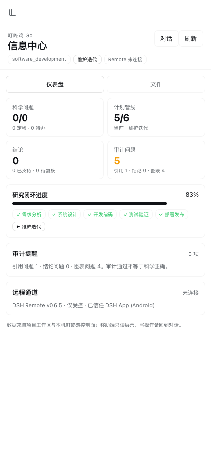
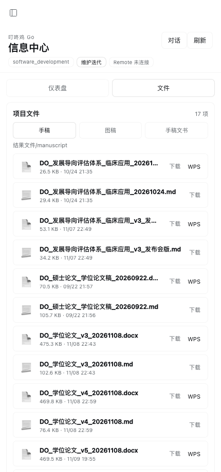
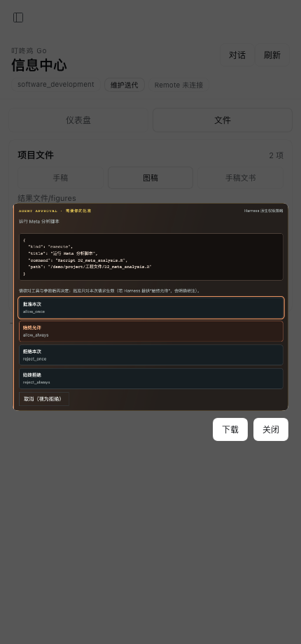

# 叮咚鸡 Go（@local/dsh-ddj-go）

面向 **DSH Go / 手机网页版** 的叮咚鸡插件：把项目仪表盘与工作区文件做成移动端友好的单列视图。
安装到 `dshgo`（SSH 托管）或 `desktop`（DSH Remote）profile 后，在左侧栏出现「叮咚鸡 Go」；
Android/手机浏览器打开时会自动切到该面板，也可随时在侧栏手动进入。

## 功能

### 1. 移动端仪表盘
- 项目名、场景、当前管线步骤、研究闭环进度条与步骤状态；
- 科学问题待办数与清单；计划管线完成度与下一步；
- 结论支持/待复核数量；审计问题（引用/结论/图表）与提醒；
- DSH Remote 通道状态（版本、在线、已信任设备、仅受控）；
- 「对话」「刷新」按钮；30 秒自动刷新。

### 2. 工作区文件
- 三个目录：`结果文件/manuscript`（手稿）、`结果文件/figures`（图稿）、`手稿文书`；
- 目录可逐级进入；图片显示缩略图并可全屏预览；
- 点击文件行/「下载」直接下载原始文件（带文件名）；
- `WPS` 按钮：优先调起系统分享（Android 分享面板中选 WPS）；不支持时自动下载，
  再用 WPS 打开。PDF/DOCX/PPTX/XLSX 都会显示 WPS 按钮。

### 3. 数据与安全
- 客户端数据全部通过工作区的 `/ddj-api` 代理（由 `@local/dsh-ddj-workbench` 提供）；
- 文件接口为后端 `GET /api/go/roots|files|download`，只允许上述三个目录，拒绝越界路径；
- 下载为只读原始字节，不写入、不修改项目；移动端不提供写操作。

## 安装

`dshgo` profile（dsh-Go 的 SSH 托管启动使用）：

```sh
dsh plugin --profile dshgo add /Users/wangdizun/ddj/plugins/dsh-ddj-go
```

`desktop` profile（DSH Remote / 桌面端使用）：
在 DSH 插件管理里安装本目录，或 `dsh plugin --profile desktop add <本目录>`，
然后重启 DSH Desktop。

依赖：当前 profile 必须已安装 `@local/dsh-ddj-workbench`（提供 `/ddj-api` 代理）。

## 构建

修改 `src/client.js` 后：

```sh
node build.mjs
```

## 截图

- 
- 
- 

## 限制

- 依赖 DSH 网页版；WPS 分享取决于 Android WebView/系统分享面板是否支持 `navigator.share(files)`。
- 文件下载大小没有额外上限，但受手机与网络能力限制；当前只读。
- 目录路径限定在三个白名单根目录，其他工作区文件请回到桌面工作台查看。


## 原生 dsh-Go 界面（v0.2.3）

`package.json` 增加 `dshGo` 清单；在带 dsh-go 桥接的主机上（本机引擎等）原生界面会出现：

- **面板**：对话详情「插件」页签、全部功能、聊天页插件弹层里的「叮咚鸡 · 仪表盘」「叮咚鸡 · 文件」；
- **输入框加号工具**：一个「叮咚鸡」入口，直接打开仪表盘面板；
- **状态条**：项目 · 管线完成度 · 当前步骤，30 秒刷新。

原生面板直接从主机工作区读取 `工程文件/00_pipeline_state.json`、`.ddj_conclusions.json`、
`citation_verification.json` 和三个文件目录，**不依赖本机 19999 后端**；图片会复制到插件
`assets/preview/` 供 App 原生图集展示（点开可保存/分享）。原生面板只读，文档下载与 WPS
仍需切到 dsh-Go 网页版。

注意：dsh-Go 原生插槽需要主机带 dsh-go 桥接（本机引擎自带；远程主机需安装 `dsh-go-bridge`）。
本机已把 `dsh-go-bridge@0.4.0` 装进 `dshgo` / `desktop` profile；desktop 需重启一次 DSH 生效。


## 原生工具卡（Remote 也能显示）

v0.2.4 起提供两个工具，结果会存进对话记录，dsh-Go App 用原生卡片渲染，**不需要 dsh-go bridge，
经 DSH Remote 连接同样显示**（这是手机原生界面的主入口）：

- `ddj_go_dashboard`：项目、管线进度/当前步骤、结论与引用问题；
- `ddj_go_files`：手稿/图稿/手稿文书目录列表。

在手机对话里直接说「打开叮咚鸡仪表盘」「列出手稿」即可。工具卡只读；下载/WPS 仍用网页版。
原生面板/侧栏（`dshGo` 插槽）只在带 bridge 的主机（本机引擎、SSH）显示；DSH Remote 不显示，
别把它当移动端主路径。
